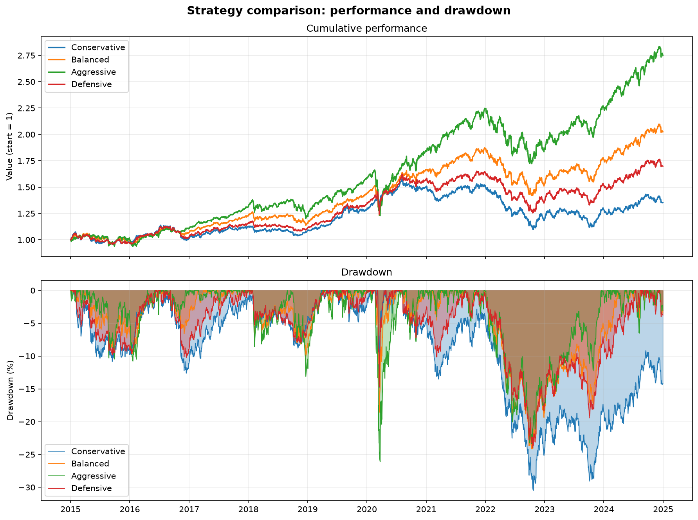
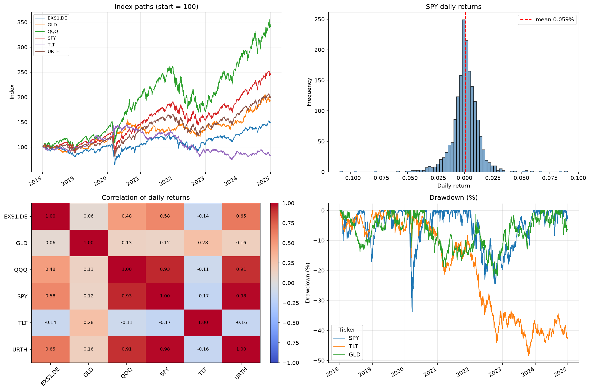
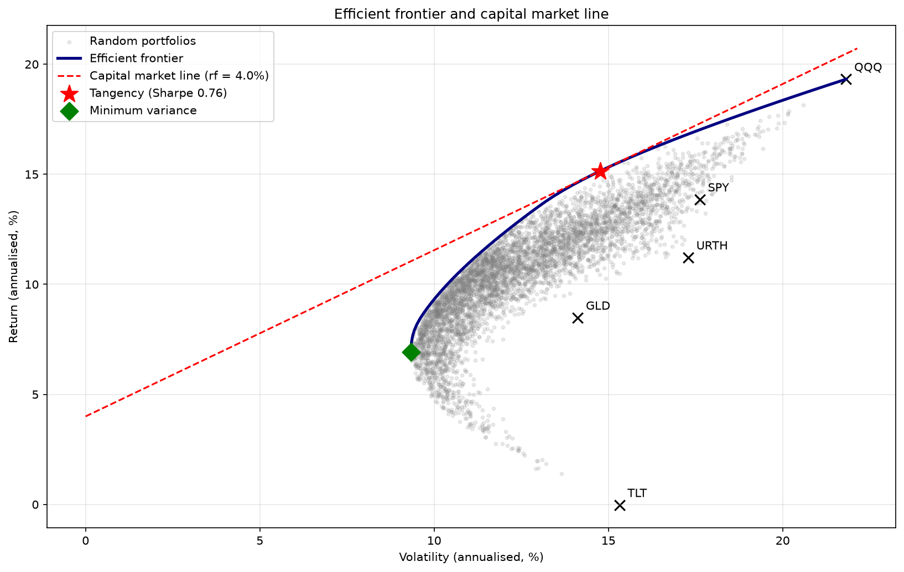
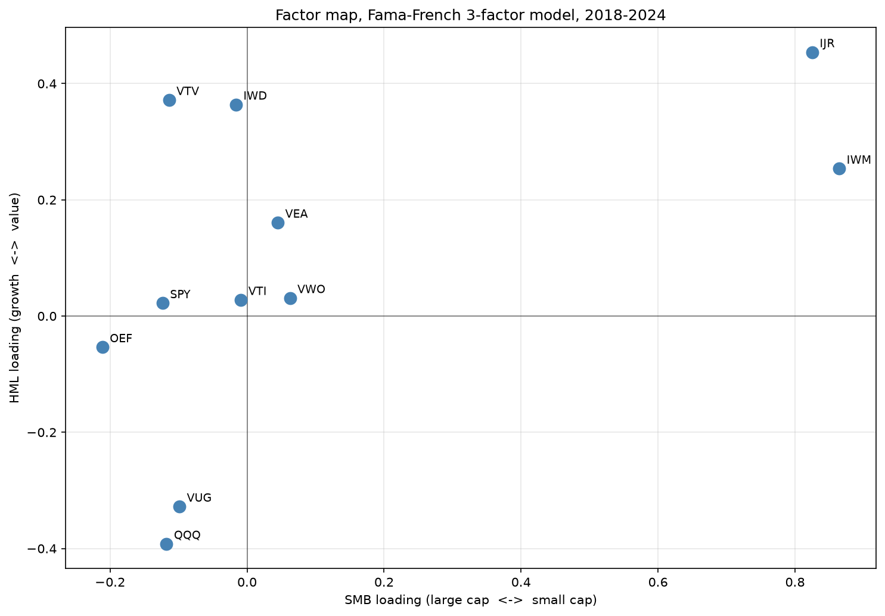
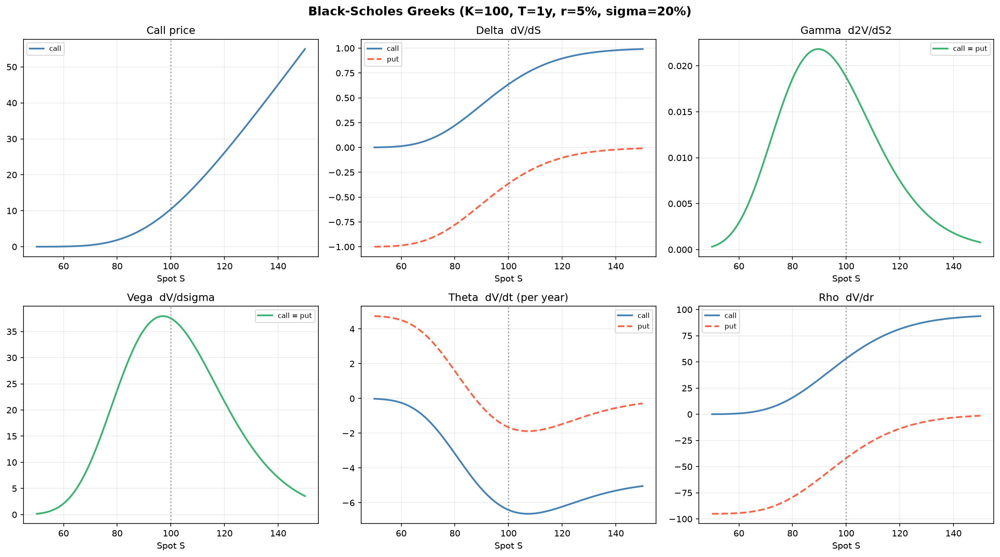
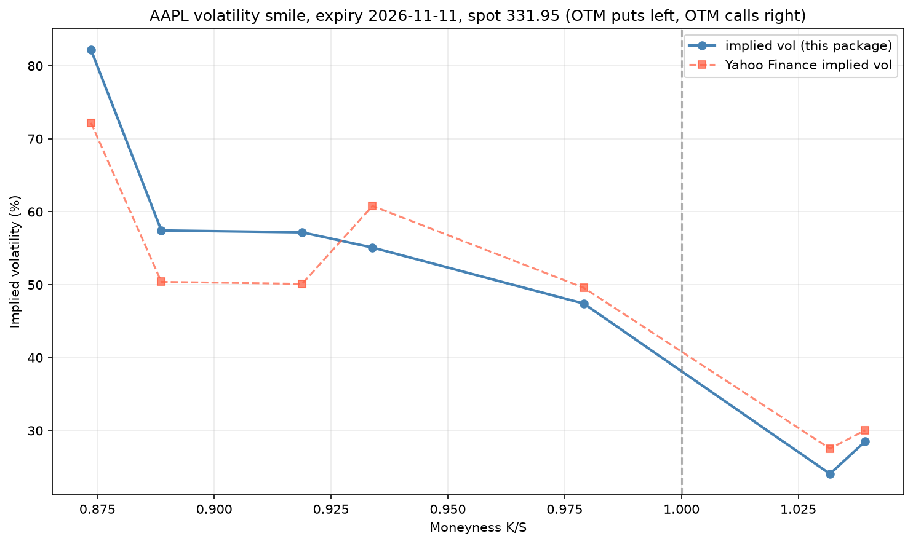
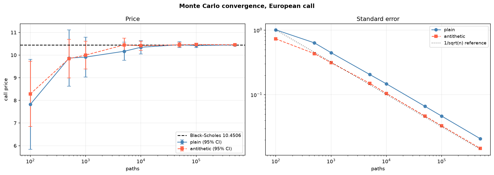

# portfolio-analytics

[](https://github.com/fatongjyliqi-ui/portfolio-analytics/actions/workflows/tests.yml)

Portfolio optimisation, factor models, backtesting and option pricing in Python,
implemented from the formulas and checked against closed-form results.

I built this between my BSc in Mathematics (University of Münster, financial
mathematics and stochastics) and my MSc at the University of Bonn, to turn the
theory from lectures into tools that run on real market data.

## Contents

| Module | What it does |
|---|---|
| `metrics` | Annualised return and volatility, Sharpe ratio, drawdown, CAGR, correlations |
| `backtest` | Static allocations with yearly, quarterly or monthly rebalancing, or buy-and-hold |
| `optimizer` | Long-only Markowitz: minimum-variance and tangency portfolios, efficient frontier, capital market line |
| `factors` | CAPM and Fama-French 3-factor regressions, rolling beta |
| `options` | Black-Scholes prices and Greeks, implied volatility (Brent), Monte Carlo with antithetic variates |
| `data` | Price download from Yahoo Finance, Fama-French factors from Kenneth French's data library |

The scripts in `examples/` use these modules on real data and produce the charts below.

## Testing

The test suite runs offline on synthetic data and checks the maths against
results that are known exactly:

- put-call parity and no-arbitrage bounds for Black-Scholes prices
- all five Greeks against central finite differences of the price
- implied volatility as a round trip (price from sigma, then recover sigma)
- Monte Carlo price inside its confidence interval around the exact price, and
  a smaller standard error with antithetic variates
- minimum-variance weights against Σ⁻¹1 / 1ᵀΣ⁻¹1 and tangency weights against
  Σ⁻¹(μ − r_f), normalised
- backtester on hand-computed paths, factor regressions on data with known loadings

```bash
pip install -e ".[dev]"
pytest
```

GitHub Actions runs the tests and `ruff` on Python 3.10 to 3.12 for every push.

## Examples

```bash
python examples/strategy_comparison.py   # four allocations, 2015-2024
python examples/etf_metrics.py           # return/risk table and correlations
python examples/etf_charts.py            # index paths, distribution, heatmap, drawdowns
python examples/efficient_frontier.py    # MVP, tangency portfolio, frontier
python examples/factor_map.py            # Fama-French loadings for 11 ETFs
python examples/greeks_dashboard.py      # Greeks as functions of spot
python examples/vol_smile.py --ticker AAPL
python examples/mc_convergence.py        # Monte Carlo vs Black-Scholes
```

Market data is downloaded on the first run, so these need an internet connection.

### Strategy comparison

Four static allocations on SPY, TLT, GLD and a DAX ETF, rebalanced yearly.



### Asset-class overview



### Efficient frontier

Minimum-variance portfolio, tangency portfolio and capital market line for five ETFs.



### Factor map

SMB and HML loadings from Fama-French 3-factor regressions for growth, value,
small-cap, large-cap and international ETFs.



### Greeks



### Volatility smile

Implied volatilities from out-of-the-money puts (left of the spot) and calls
(right), computed with `implied_vol` and compared with the values Yahoo reports.
The skew towards low strikes is the market pricing crash risk, which constant
volatility in Black-Scholes cannot capture.



### Monte Carlo convergence

Both estimators converge at the 1/√n rate. Antithetic variates cut the variance
by about half here, which is about 30 % less standard error at the same cost.



## Conventions

- Daily close-to-close returns from split- and dividend-adjusted prices
- Annualisation with 252 trading days: mean × 252, volatility × √252
- Sharpe ratio uses the arithmetic mean everywhere, so tables and the optimiser agree;
  backtest results also report CAGR
- Sample statistics (ddof = 1)
- With antithetic variates the standard error is computed from the pair averages
  (f(Z) + f(−Z)) / 2, because Z and −Z are not independent

## Limitations

- The efficient frontier is estimated in-sample. Errors in μ make optimal weights
  unstable, and out of sample an equal-weight portfolio is often hard to beat.
- Optimisation is long-only; short positions are not modelled.
- No transaction costs or taxes in the backtests.
- Black-Scholes assumes constant volatility and no dividends. The smile shows the
  first assumption fails; ignoring dividends explains part of the gap to Yahoo's
  implied vols.

## Next steps

- American and Bermudan options: CRR binomial tree and Longstaff-Schwartz
  Monte Carlo, validated against published reference values
- Out-of-sample backtest of the Markowitz portfolios with rolling estimates of μ and Σ

## Layout

```
src/portfolio_analytics/   library code
examples/                  scripts that produce the analyses and plots
tests/                     pytest suite (offline)
plots/                     generated charts
```

## License

MIT
