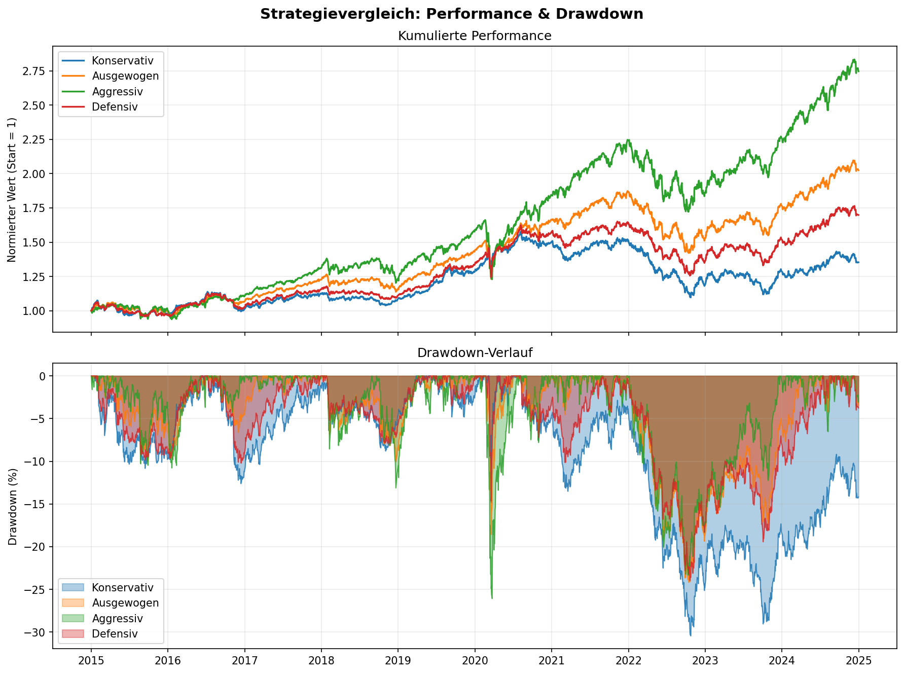
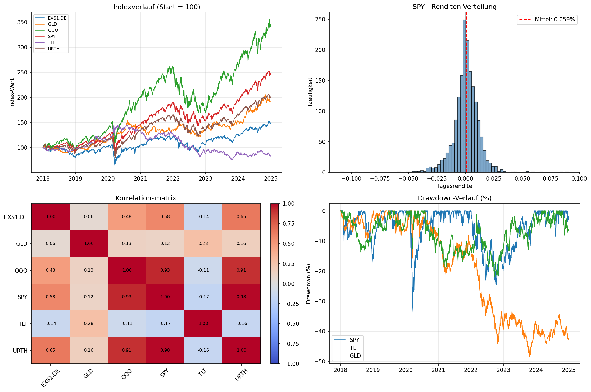
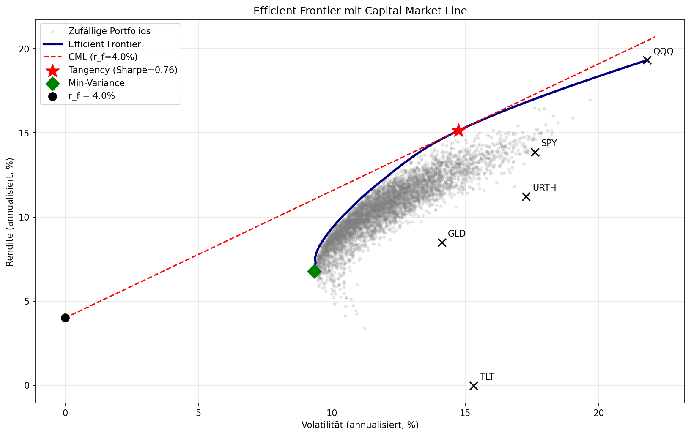
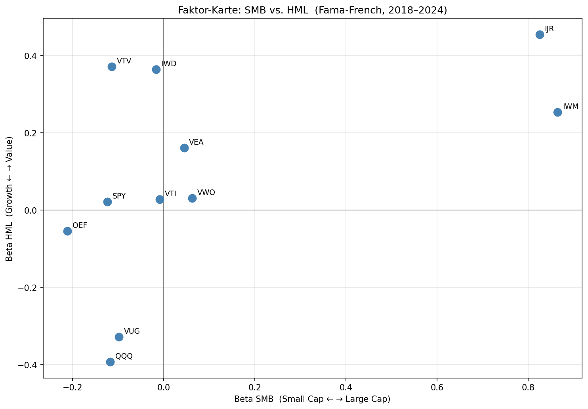
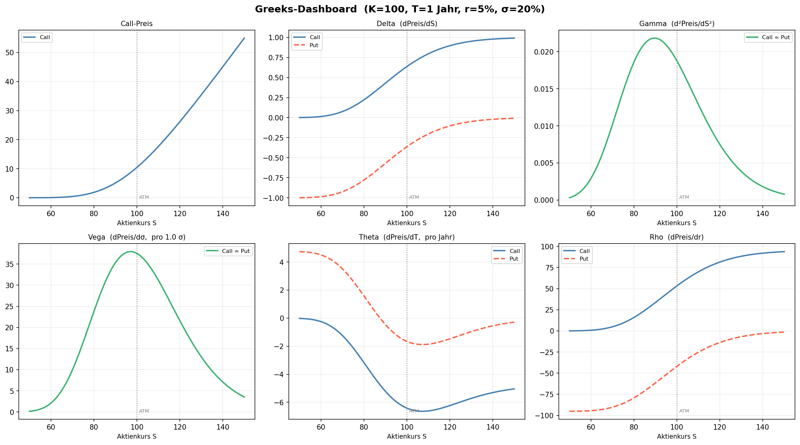
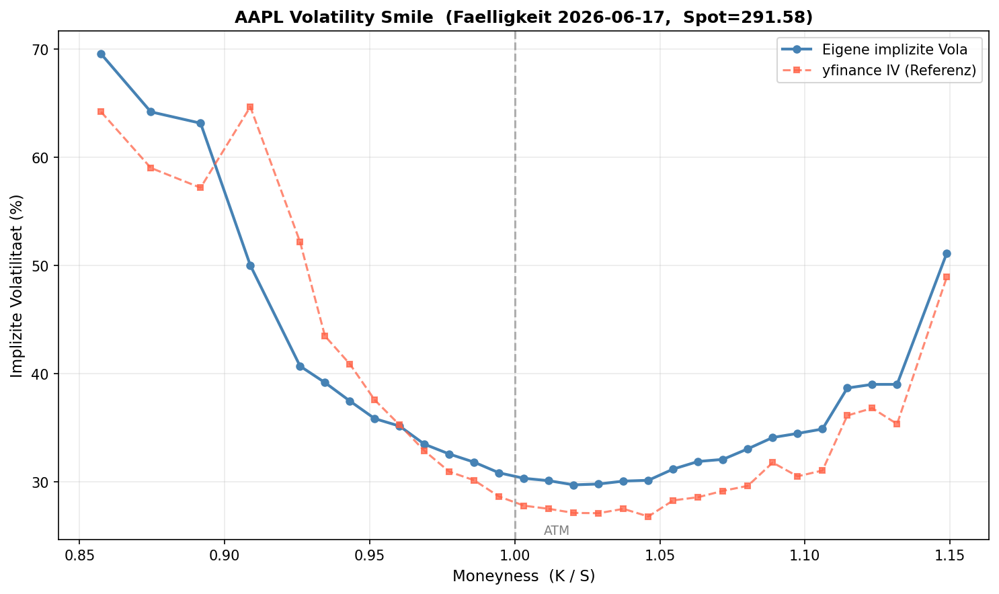
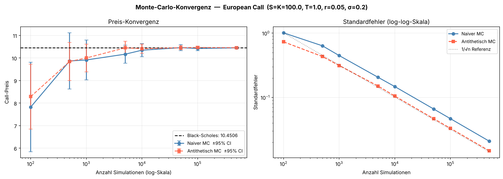

# portfolio-analytics

Quantitative Portfolio- und Optionsanalyse mit Python — eigene Implementierung von Markowitz-Optimierung, Faktormodellen, Backtesting, Black-Scholes-Greeks, impliziter Volatilität und Monte-Carlo-Pricing auf realen Marktdaten.

> **English summary:** Self-built Python toolkit for quantitative finance: Markowitz optimisation (minimum-variance, tangency portfolio, capital market line), CAPM and Fama-French 3-factor regressions, a rebalancing backtester, Black-Scholes pricing with all Greeks, implied-volatility smiles from live option chains, and a Monte Carlo pricer with antithetic variates. Core formulas are verified by an automated test suite (put-call parity, Greeks vs. finite differences, MC vs. closed form, optimiser vs. analytical solution).

---

## Was das Projekt kann

- **Renditen-Statistik:** Volatilität, Sharpe Ratio, Max Drawdown, Verteilungs-Klassifizierung — sowohl für einzelne Renditefolgen als auch für ein Asset-Universum
- **Marktdaten-Pipeline:** Automatischer Datenabruf via yfinance, Cleaning auf gemeinsame Handelstage
- **Backtesting-Engine:** Buy-and-Hold sowie periodisch rebalancierte Portfolio-Strategien mit beliebigen Asset-Gewichtungen
- **ETF-Analyse:** Performance- und Risiko-Vergleich mehrerer Anlageklassen über lange Zeiträume
- **Portfolio-Optimierung:** Minimum-Varianz- und Tangency-Portfolio, Efficient Frontier, Capital Market Line
- **Faktormodelle:** CAPM- und Fama-French-3-Faktor-Regressionen, Rolling Beta
- **Optionen:** Black-Scholes-Preise, alle Greeks, implizite Volatilität (Brent), Monte Carlo mit antithetischen Variaten
- **Visualisierung:** Indexverläufe, Renditen-Verteilungen, Korrelations-Heatmaps, Drawdown-Charts
- **Tests:** 31 automatisierte Tests prüfen die mathematischen Kernfunktionen gegen exakte Resultate

---

## Beispiel-Ergebnisse

### Strategievergleich: 4 Asset-Allokationen über 10 Jahre

Vergleich konservativer, ausgewogener, aggressiver und defensiver Portfolios auf SPY (US-Aktien), TLT (US-Treasuries), GLD (Gold) und EXS1.DE (DAX) mit jährlichem Rebalancing.



### ETF-Übersicht: 6 Welt-Assets seit 2018

Indexverläufe, Renditen-Verteilung, Korrelationen und Drawdown-Verläufe für die wichtigsten globalen Anlageklassen.



### Portfolio-Optimierung & Faktor-Analyse

**Efficient Frontier mit Capital Market Line** — Min-Variance-Portfolio, Tangency-Portfolio und CML für ein 5-Asset-Universum (SPY, QQQ, URTH, TLT, GLD).



**Faktor-Karte: SMB vs. HML** — Fama-French-3-Faktor-Exposures für 11 ETFs (Growth, Value, Small Caps, Large Caps, International). Zeigt visuell, wie sich ETFs im zweidimensionalen Faktor-Raum positionieren.



### Optionen und Black-Scholes

**Greeks-Dashboard** — alle fünf partiellen Ableitungen des Black-Scholes-Preises (Delta, Gamma, Vega, Theta, Rho) als Funktion des Aktienkurses. Jeder Greek mit Call und Put in einem 6-Panel-Dashboard.



**Volatility Smile** — implizite Volatilität als Funktion der Moneyness (K/S). Demonstriert, dass Black-Scholes eine Vereinfachung ist: der Markt bewertet OTM-Puts mit einer Risikoprämie.



**Monte-Carlo-Pricing mit Varianzreduktion** — Konvergenz des MC-Preises gegen die exakte Black-Scholes-Lösung samt 95-%-Konfidenzintervallen. Antithetische Variaten senken den Standardfehler bei gleicher Rechenzeit um rund 30 % (Varianz rund −50 %); beide Verfahren folgen der theoretischen 1/√n-Rate.



---

## Setup

```bash
pip install -r requirements.txt
```

Benötigt Python 3.10+ und folgende Bibliotheken: NumPy, Pandas, Matplotlib, SciPy, statsmodels, yfinance (für die Tests zusätzlich pytest).

---

## Repo-Struktur

```
portfolio-analytics/
├── README.md
├── requirements.txt
│
├── analytics.py                 # Werkzeug-Modul: Performance- und Risiko-Kennzahlen
├── backtester.py                # Werkzeug-Modul: Portfolio-Simulation mit Rebalancing
├── optimizer.py                 # Werkzeug-Modul: Markowitz-Optimierung & Frontier
├── factor_analysis.py           # Werkzeug-Modul: CAPM- und Fama-French-Regressionen
├── options.py                   # Werkzeug-Modul: Black-Scholes, Greeks, IV, Monte Carlo
├── rendite_analyzer.py          # Eigenständiges Tool: Statistik-Report für Renditefolgen
│
├── etf_kennzahlen.py            # Anwendung: ETF-Universum-Analyse (Tabelle)
├── etf_charts.py                # Anwendung: ETF-Universum-Visualisierung
├── strategievergleich.py        # Anwendung: Portfolio-Strategien-Backtest
├── efficient_frontier_demo.py   # Anwendung: Frontier-Plot mit Tangency & CML
├── factor_profile_etfs.py       # Anwendung: Fama-French-Faktoranalyse für ETFs
├── greeks_dashboard.py          # Anwendung: Greeks-Dashboard (6 Panels)
├── vol_smile.py                 # Anwendung: Volatility Smile (Markt- oder Synthetik)
├── mc_pricer.py                 # Anwendung: MC-Pricer mit Varianzreduktion & Konvergenz
│
├── tests/                       # pytest-Suite (läuft ohne Internet, synthetische Daten)
│   ├── test_options.py
│   └── test_portfolio.py
│
└── plots/                       # Generierte Charts
    ├── etf_charts.png
    ├── strategievergleich.png
    ├── efficient_frontier.png
    ├── faktor_karte.png
    ├── greeks_dashboard.png
    ├── vol_smile.png
    └── mc_konvergenz.png
```

**Werkzeug-Module** enthalten die wiederverwendbaren Funktionen. **Anwendungs-Skripte** importieren aus den Werkzeug-Modulen und produzieren konkrete Analysen.

---

## Wie ausführen

Alle Anwendungs-Skripte sind eigenständig ausführbar:

```bash
python rendite_analyzer.py          # Beispiel-Renditen analysieren
python etf_kennzahlen.py            # ETF-Kennzahlen-Tabelle ausgeben
python etf_charts.py                # ETF-Charts erzeugen (in plots/)
python strategievergleich.py        # Strategien backtesten und plotten
python efficient_frontier_demo.py   # Frontier-Plot mit Tangency & CML
python factor_profile_etfs.py       # Faktor-Exposures für ETF-Universum
python greeks_dashboard.py          # Greeks-Dashboard erzeugen (in plots/)
python vol_smile.py                 # Volatility Smile erzeugen (in plots/)
python mc_pricer.py                 # MC-Konvergenzanalyse erzeugen (in plots/)
```

Beim ersten Lauf werden die Daten über yfinance live von Yahoo Finance geladen — dafür ist eine Internetverbindung nötig.

## Tests

```bash
pip install pytest
pytest
```

Die Tests laufen ohne Internetverbindung und prüfen unter anderem:

- **Put-Call-Parität** und Arbitragegrenzen der Black-Scholes-Preise
- **Greeks** (Delta, Gamma, Vega, Theta, Rho) gegen zentrale Differenzenquotienten
- **Implizite Volatilität** als Rundreise: Preis aus σ berechnen, σ zurückgewinnen
- **Monte Carlo** liegt im Konfidenzintervall um den exakten Preis; antithetische Variaten senken den Standardfehler
- **Optimizer:** Minimum-Varianz-Portfolio stimmt mit der geschlossenen Lösung Σ⁻¹1 / 1ᵀΣ⁻¹1 überein; das Tangency-Portfolio schlägt 2.000 Zufallsportfolios
- **Backtester** und **CAPM-Regression** auf Daten mit bekanntem Ergebnis

---

## Methodische Notizen

- Renditen sind Closing-zu-Closing (täglich), berechnet aus dividend- und split-bereinigten Schlusskursen (`auto_adjust=True`)
- Annualisierung: Renditen mit Faktor 252 (Handelstage pro Jahr), Volatilitäten mit √252 (Wurzel-T-Regel)
- Volatilität wird auf den **Renditen** berechnet, nicht auf den Preisen
- Annualisierte Rendite im Backtester als geometrisches Mittel (Compound Annual Growth Rate), um Verzerrung durch arithmetische Mittelung über lange Zeiträume zu vermeiden
- **Sharpe Ratio** projektweit einheitlich (`analytics.sharpe_ratio`): (arithmetische Jahresrendite − r_f) / Jahresvolatilität — dieselbe Konvention wie in der Markowitz-Optimierung. In den Kennzahlen-Tabellen ist r_f = 0 (reiner Vergleich), in der Optimierung r_f = 2 %
- Monte-Carlo-Standardfehler bei antithetischen Variaten aus den unabhängigen Paar-Mittelwerten (f(Z) + f(−Z)) / 2
- Stichproben-Statistik (ddof=1) für Standardabweichungen
- Rebalancing-Frequenzen: jährlich, quartalsweise, monatlich, oder Buy-and-Hold
- Keine Transaktionskosten — bei Interpretation der Ergebnisse beachten

**Grenzen der Methoden**

- Die Efficient Frontier ist **in-sample** geschätzt: μ und Σ stammen aus demselben Zeitraum, in dem das Portfolio bewertet wird. Schätzfehler (insbesondere bei μ) machen die optimalen Gewichte instabil — out-of-sample ist ein Gleichgewichtsportfolio oft schwer zu schlagen
- Optimierung **long-only** (Gewichte zwischen 0 und 1, Summe 1); Leerverkäufe sind nicht modelliert
- Black-Scholes unterstellt konstante Volatilität — der Volatility Smile zeigt, dass der Markt das nicht tut
- Die implizite Volatilität wird ohne Dividenden berechnet; das erklärt einen Teil der Abweichung zur yfinance-Referenz

---

## Ausblick

- Amerikanische und Bermuda-Optionen: Binomialbaum (CRR) und Longstaff-Schwartz-Monte-Carlo, validiert gegen bekannte Referenzwerte
- Out-of-Sample-Backtest der Markowitz-Portfolios mit rollierender Schätzung von μ und Σ

---

## Hintergrund

Das Projekt ist in der Zeit zwischen meinem Mathematik-Bachelor (Universität Münster, Schwerpunkt Finanzmathematik und Stochastik) und dem Master in Mathematik an der Universität Bonn entstanden.

Ziel ist es, die mathematischen Grundlagen der modernen Portfoliotheorie nicht nur theoretisch zu verstehen, sondern in eigenständig implementierten, transparenten und auf realen Daten validierten Tools umzusetzen — als Vorbereitung auf eine Tätigkeit im quantitativen Asset Management und Risikomanagement.
